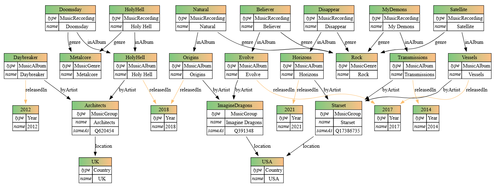

# Лабораторна робота №1 — RDF та SPARQL

**Тема:** Технології Semantic Web: RDF та SPARQL
**Предметна область:** музика — гурти Starset, Architects, Imagine Dragons, їхні альбоми, композиції, жанри, роки та країни
**Стек:** Python, RDFLib; візуалізація — зовнішній сервіс

---

## 1. Предметна область, джерела даних і запитання

Дані сформовано вручну на основі загальновідомої інформації про дискографії трьох гуртів. Жанр у графі прив'язаний до композицій.

| Гурт            | Країна | Альбоми (рік)                                         | Композиції в графі              |
| --------------- | ------ | ----------------------------------------------------- | ------------------------------- |
| Starset         | USA    | Transmissions (2014), Vessels (2017), Horizons (2021) | My Demons, Satellite, Disappear |
| Architects      | UK     | Daybreaker (2012), Holy Hell (2018)                   | Holy Hell, Doomsday             |
| Imagine Dragons | USA    | Evolve (2017), Origins (2018)                         | Believer, Natural               |

**Запитання до графу** (кожне має відповідний SPARQL-запит у п. 4):

1. Які альбоми вийшли після 2015 року? — запит 1 (FILTER)
2. У якому порядку (за роком) вийшли всі альбоми? — запит 2 (ORDER BY)
3. Які композиції належать жанру Rock? — запит 3 (зв'язок між типами сутностей)
4. Скільки альбомів у кожного виконавця? — запит 4 (COUNT)
5. З якої країни виконавець кожної композиції? — запит 5 (перехід через 3 зв'язки)
6. Який ресурс Wikidata відповідає гурту з нашого графу? — запит 6 (локальний граф + Wikidata)

---

## 2. Структура RDF-графу

Простори імен:

```
ex     = http://example.org/myMysic/     (власний, усі ресурси мають власні URI)
schema = http://schema.org/              (існуючий словник Schema.org)
owl    = http://www.w3.org/2002/07/owl#  (owl:sameAs для зв'язку з Wikidata)
```

**Типи сутностей — 6** (вимога ≥ 5):

| Клас                    | Екземплярів | Походження класу                                                          |
| ----------------------- | ----------- | ------------------------------------------------------------------------- |
| `schema:MusicGroup`     | 3           | Schema.org                                                                |
| `schema:MusicAlbum`     | 7           | Schema.org                                                                |
| `schema:MusicRecording` | 7           | Schema.org                                                                |
| `schema:Country`        | 2           | Schema.org                                                                |
| `ex:MusicGenre`         | 2           | власний клас (у Schema.org є лише властивість `genre`, класу жанру немає) |
| `ex:Year`               | 5           | власний клас                                                              |

**Екземплярів сутностей — 26** (вимога ≥ 20).

**Типи зв'язків (предикати) — 8** (вимога ≥ 5):

| Предикат          | Зв'язок                    | Словник    |
| ----------------- | -------------------------- | ---------- |
| `schema:byArtist` | Альбом → Гурт              | Schema.org |
| `schema:inAlbum`  | Композиція → Альбом        | Schema.org |
| `schema:genre`    | Композиція → Жанр          | Schema.org |
| `schema:location` | Гурт → Країна              | Schema.org |
| `ex:releasedIn`   | Альбом → Рік               | власний    |
| `schema:name`     | сутність → назва (літерал) | Schema.org |
| `rdf:type`        | сутність → клас            | RDF        |
| `owl:sameAs`      | Гурт → ресурс Wikidata     | OWL        |

**Загальна кількість трійок — 86** (вимога ≥ 50).

### Візуалізація графу

Граф візуалізовано на зовнішньому сайті: **https://giacomociti.github.io/rdf2dot/**. У нього завантажено `MyMusic_graph.ttl`.



---

## 3. Приклади RDF-трійок і Turtle

Фрагмент `MyMusic_graph.ttl`:

```turtle
@prefix ex: <http://example.org/myMysic/> .
@prefix owl: <http://www.w3.org/2002/07/owl#> .
@prefix schema: <http://schema.org/> .

<http://example.org/myMysic/artist/Starset> a schema:MusicGroup ;
    schema:location <http://example.org/myMysic/country/USA> ;
    schema:name "Starset" ;
    owl:sameAs <http://www.wikidata.org/entity/Q17386735> .

<http://example.org/myMysic/album/Vessels> a schema:MusicAlbum ;
    ex:releasedIn <http://example.org/myMysic/year/2017> ;
    schema:byArtist <http://example.org/myMysic/artist/Starset> ;
    schema:name "Vessels" .

<http://example.org/myMysic/song/Satellite> a schema:MusicRecording ;
    schema:genre <http://example.org/myMysic/genre/Rock> ;
    schema:inAlbum <http://example.org/myMysic/album/Vessels> ;
    schema:name "Satellite" .
```

**Робота з графом:**

- граф серіалізовано у Turtle (`MyMusic_graph.ttl`) і RDF/XML (`music_graph.xml`);
- Turtle-файл прочитано назад у новий граф, додано новий трек (`NewTestSong`), результат збережено у `MyMusic_graph_edited.ttl` (88 трійок проти 86);
- на консоль виводяться перші 5 трійок графу та всі трійки, пов'язані з гуртом Starset (тип, країна, назва).

---

## 4. SPARQL-запити та результати

Усі запити — у файлі `queries.py`; префікси: `ex:` `schema:` `owl:` `rdfs:`.

### Запит 1 — FILTER: альбоми після 2015 року

```sparql
SELECT ?albumName ?yearNum WHERE {
    ?album schema:name ?albumName ;
           ex:releasedIn ?year .
    ?year schema:name ?yearNum .
    FILTER (?yearNum > 2015)
}
```

```
Vessels   | 2017
Evolve    | 2017
Horizons  | 2021
Holy Hell | 2018
Origins   | 2018

```

### Запит 2 — ORDER BY: усі альбоми за роком (спадання)

```sparql
SELECT ?albumName ?yearNum WHERE {
    ?album schema:name ?albumName ;
           ex:releasedIn ?year .
    ?year schema:name ?yearNum .
}
ORDER BY DESC(?yearNum) ?albumName
```

```
Horizons      | 2021
Holy Hell     | 2018
Origins       | 2018
Vessels       | 2017
Evolve        | 2017
Transmissions | 2014
Daybreaker    | 2012
```

### Запит 3 — зв'язок між типами сутностей: композиції жанру Rock

```sparql
SELECT ?songName WHERE {
    ?song schema:genre <http://example.org/myMysic/genre/Rock> ;
          schema:name ?songName .
}
```

```
Me Demons
Satellite
Disappear
Believer
Natural
```

### Запит 4 — агрегатна функція COUNT: альбомів на виконавця

```sparql
SELECT ?artistName (COUNT(?album) AS ?numAlbums) WHERE {
    ?album schema:byArtist ?artist .
    ?artist schema:name ?artistName .
}
GROUP BY ?artistName
ORDER BY DESC(?numAlbums) ?artistName
```

```
Starset         | 3
Architects      | 2
Imagine Dragons | 2
```

### Запит 5 — перехід через 3 зв'язки: Song → Album → Artist → Country

(`schema:inAlbum` → `schema:byArtist` → `schema:location`)

```sparql
SELECT ?songName ?countryName WHERE {
    ?song   schema:inAlbum ?album ;
            schema:name ?songName .
    ?album  schema:byArtist ?artist .
    ?artist schema:location ?country .
    ?country schema:name ?countryName .
}
```

```
My Demons  | USA
Satellite  | USA
Disappear  | USA
Holy Hell  | UK
Doomsday   | UK
Believer   | USA
Natural    | USA
```

---

## 5. Зв'язок із Wikidata

Для кожного гурту створено зв'язок `owl:sameAs` із відповідним ресурсом Wikidata:

| Власний ресурс                                     | Ресурс Wikidata                            |
| -------------------------------------------------- | ------------------------------------------ |
| `http://example.org/myMysic/artist/Starset`        | `http://www.wikidata.org/entity/Q17386735` |
| `http://example.org/myMysic/artist/Architects`     | `http://www.wikidata.org/entity/Q620454`   |
| `http://example.org/myMysic/artist/ImagineDragons` | `http://www.wikidata.org/entity/Q391348`   |

**Обгрунтування предиката.** `owl:sameAs` означає, що два URI позначають одну й ту саму реальну сутність. Саме це й потрібно: наш ресурс гурту і ресурс Wikidata описують той самий гурт, тож дані з обох графів можна поєднувати. Предикати на кшталт `rdfs:seeAlso` чи `schema:sameAs` слабші (лише «див. також»), а `owl:sameAs` — стандартний спосіб зв'язування у Linked Open Data.

### Запит 6 — локальний граф + Wikidata (federated SPARQL)

```sparql
SELECT ?localName ?wikiEntity ?wikiLabel WHERE {
    ?artistUri schema:name ?localName ;
               owl:sameAs ?wikiEntity .
    SERVICE <https://query.wikidata.org/sparql> {
        ?wikiEntity rdfs:label ?wikiLabel .
        FILTER(LANG(?wikiLabel) = "en")
    }
}
ORDER BY ?localName
```

Запит бере назву гурту з локального графу, а англомовну мітку відповідного ресурсу — з Wikidata. Результат виконання:

```
Starset             | Q17386735 | Starset
Architects          | Q620454   | Architects
Imagine Dragons     | Q391348   | Imagine Dragons
```

---

## 6. Помилковий та виправлений приклад

**Помилка.** У запиті 3 жанр було записано як `ex:genre\/Rock` (спроба екранувати `/`, бо `ex:genre/Rock` у SPARQL не парситься — `/` там означає property path):

```sparql
?song schema:genre ex:genre\/Rock ;     # неправильно
```

RDFLib не знімає екранування `\/`, тому шукає URI `http://example.org/myMysic/genre\/Rock` (зі зворотним слешем). Такого URI в графі немає, тож запит **без помилки повертає 0 рядків**, а в консолі лише попередження _«does not look like a valid URI»_. Також Python 3.12 видає `SyntaxWarning: invalid escape sequence '\/'`.

**Виправлення.** Записати ресурс повним URI в кутових дужках:

```sparql
?song schema:genre <http://example.org/myMysic/genre/Rock> ;   # правильно
```

---

## 7. Висновки

Побудовано RDF-граф предметної області «музика» на Python з RDFLib: 6 типів сутностей, 26 екземплярів, 8 типів зв'язків, 86 трійок із власними URI та словником Schema.org (а також OWL для зв'язку з Wikidata). Граф серіалізовано у Turtle та RDF/XML, візуалізовано на зовнішньому сайті; Turtle-файл прочитано назад і змінено. Виконано 5 SPARQL-запитів до власного графу (FILTER, сортування, зв'язки між типами сутностей, COUNT, перехід через 3 зв'язки) і один federated-запит, що поєднує локальний граф із Wikidata через `owl:sameAs`.

---

## 8. Використання AI

Асистенти (Claude, Gemini) використовувалися для: пояснення синтаксису RDF/Turtle і SPARQL; перевірки коду та запитів на помилки (виявлення проблеми з `\/` у запиті 3, змішаних `http`/`https` у URI Wikidata, незбереженого відредагованого графу); оформлення цього README.
